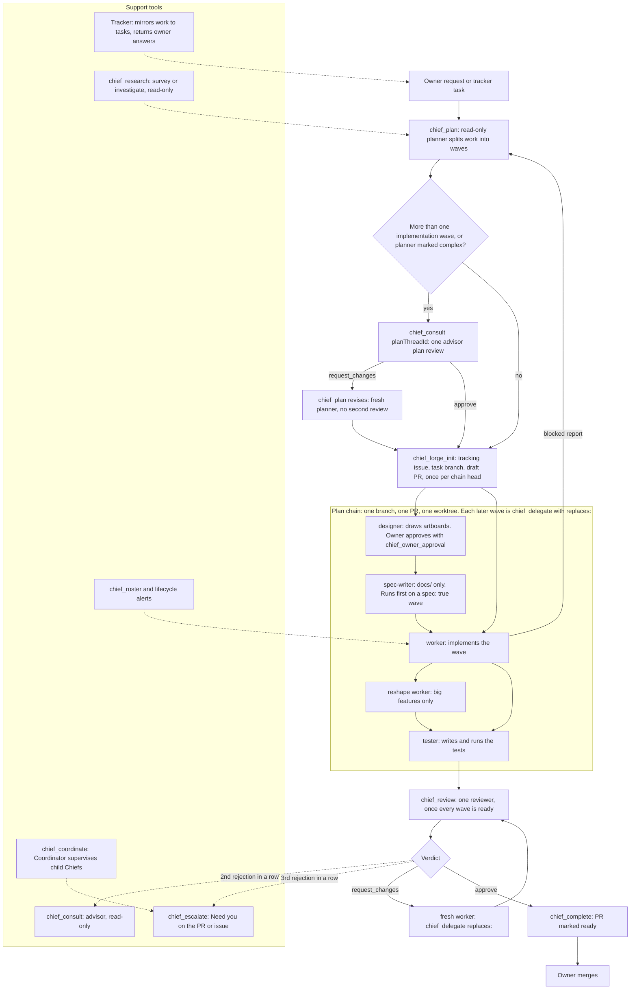

# Software Factory

This page shows how Chief turns one request into a merged pull request: the pipeline, the roles inside a plan chain, and the support tools around them.

> **Keep this page current.** When a change alters a tool, a role kind, a gate, or the order of steps, update the chart and the tables in the same pull request. The code and the skills win over this page: `server.ts`, `roles.ts`, `skills/chief/SKILL.md` and the README "Workflow" and "Planning" sections.

## Chart

## Steps and gates

| Step | Tool | Rule |
| --- | --- | --- |
| Plan | `chief_plan` | With planning on, `chief_delegate` refuses a call without `planThreadId` and `wave`, unless it carries `unplannedReason`. A plan has 2 to 8 waves and ends each chain with a test wave. |
| Plan review | `chief_consult` with `planThreadId` | A plan with more than one implementation wave, or marked `complex`, gets one advisor review. `chief_forge_init` and `chief_delegate` refuse the plan until it resolves. A single-wave plan skips it. |
| Forge | `chief_forge_init` | Chief owns the forge. It runs once for each plan chain, on the head wave only. A worker never touches the pull request. |
| Build | `chief_delegate` | Each later wave of a chain uses `replaces:` the chain's latest worker. An independent wave (`dependsOn: []`) starts its own chain, branch and pull request. |
| Review | `chief_review` | An intermediate wave gets no review. When every wave is ready, one reviewer covers the whole plan. Chief may use `skipReview` on `chief_complete` with a reason. |
| Complete | `chief_complete` | It needs the newest review to approve the pull request's current head, or `skipReview`, or `override` with a reason. It marks the pull request ready. A design wave needs the owner's approval. |
| Merge | none | Only the owner merges. Chief never merges. |

## Roles inside a plan chain

Roles are `worker` rows with a `kind` (`workerKindSchema` in `roles.ts`), except the read-only roles below.

| Role | Kind or thread role | Job | Waived by |
| --- | --- | --- | --- |
| Designer | `kind: "designer"` | Decides or implements how the UI looks. A design-only wave draws artboards, and the owner approves them before the next wave. | Not waived. |
| Spec Writer | `kind: "spec-writer"` | Changes only `docs/`. Runs first on a wave that the plan marks `spec: true`. The worker then implements against those docs. | `chief_skip_specs` |
| Worker | `kind: "worker"` | Implements one wave and commits to the task branch. It never writes tests. | Not waived. |
| Reshape | `kind: "worker"` | Extra wave for a big feature. It applies the make-native skill and commits the reshape separately. | The planner decides. |
| Tester | `kind: "tester"` | Writes and runs the tests for the waves it builds on. | `chief_skip_tests`, or `testsSkipped` on `chief_complete` |
| Reviewer | thread role `reviewer` | Reads the code and reports a `verdict` of `approve` or `request_changes`. It never edits. | `skipReview` |
| Planner and Advisor | thread roles `planner`, `advisor` | Read-only. The planner writes the wave plan. The advisor reviews a plan or helps a stuck review. | Plan review has no skip. |

A fresh worker takes every follow-up through `replaces:`. A worker that already reported is never reused.

## Support tools

| Tool | Use |
| --- | --- |
| `chief_research` | Read-only survey or investigation by a researcher thread. Chief uses it before a plan or to check doubtful evidence. |
| `chief_consult` | Read-only advisor. Chief must call it after the second `request_changes` in a row on one task. |
| `chief_roster` | Starts every Chief turn. Its Pending block is the work list. Lifecycle alerts name the next call. |
| `chief_escalate` | Posts a **Need you** request on the pull request or issue with an @mention of the owner. Chief also writes it in chat. After the third `request_changes` in a row, Chief stops and escalates. |
| `chief_coordinate` | Upgrades a Chief to a Coordinator. It supervises child Chiefs through `chief_attach` and `chief_spawn`, and wakes only on a child's Need you or done. |
| Tracker | Optional. Mirrors each plan or unplanned worker to a task. The owner's answer on the task reaches Chief once, as an alert. |

## Related

- [Plan chains](specs/plan-chains.md)
- [Review engine](specs/review-engine.md)
- [Work list](specs/work-list.md)
- [Coordinator](specs/coordinator.md)
- [Tracker](specs/tracker.md)
- [Forge comments](specs/forge-comments.md)
