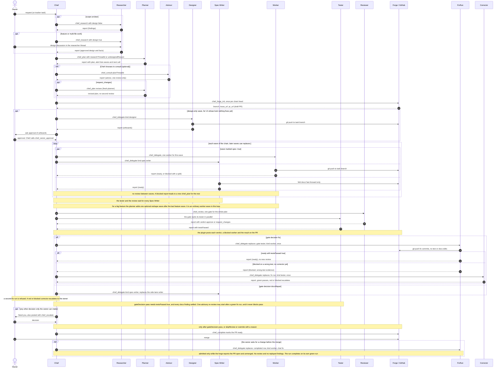
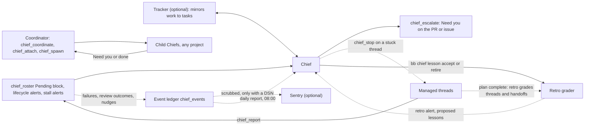

# Software Factory

This page shows how Chief turns one owner request into a merged pull request. The sequence chart shows who messages whom. The tables list the roles and the support tools.

> **Keep this page current.** When a change alters a tool, a role kind, a gate, or the order of steps, update the charts and tables in the same pull request. The code and the skills win over this page: `src/plan/planLifecycle.ts`, `src/runtime/delegation.ts`, `src/core/roles.ts`, `skills/chief/SKILL.md`, and the README "Workflow" and "Planning" sections.

## Chart

> **Note.** The waves of one chain run one after another on one branch, each worker continuing the last through `replaces:`. A Spec Writer runs beside the worker of its wave in a side worktree and folds `docs/` onto the same branch. Separate chains (separate branches and pull requests, started with `dependsOn: []`) can run in parallel.

A solid arrow is a tool call or a push. A dashed arrow is a `chief_report` that the plugin turns into a lifecycle alert for Chief, or an owner message. Every managed thread reports to Chief only. Threads never message each other. The one exception is the pull-only plan log (`chief_log`), which carries no alert.

## Support tools

Support tools run beside the pipeline. This chart shows who reaches Chief and who does not.

| Tool | Use |
| --- | --- |
| `chief_research` | Read-only research by a researcher thread: ticket-blind facts from helper threads. With `design: true`, it also runs a design discussion with the user in its own thread and reports an approved design.md. Chief uses `design: true` for features and multi-file work, and `design: false` to check doubtful evidence. |
| `chief_consult` | Optional read-only advisor: one review of a plan, when Chief asks. |
| `chief_roster` | Starts every Chief turn. Its Pending block is the work list. |
| `chief_escalate` | Posts a **Need you** request on the pull request or issue with an @mention of the owner. Chief also writes it in chat. |
| `chief_stop` | Interrupts a stuck thread. It keeps the worktree, branch and history. |
| `chief_coordinate` | Upgrades a Chief to a Coordinator. It wakes only on a child's Need you or done. |
| Tracker | Mirrors each plan or unplanned worker to a task. The owner's answer on the task reaches Chief once, as an alert. |
| Event ledger | Records each failure, review outcome and nudge once in `chief_events`. With a Sentry DSN, it also sends scrubbed failure and review events to Sentry. Without a DSN, it makes no network call. A daily report at 08:00 summarizes failures from the ledger, the logs, the provider files and Sentry. |
| Completion evidence | Stores the PR, the final diff and the exact brief of each worker when it completes, before cleanup can clear them. |
| Retro grader | When a plan completes, a read-only judge scores its threads and the Chief handoffs against versioned rubrics. It writes `retro.md` and alerts Chief. |
| Lessons | A reviewer, an advisor or the retro can propose a lesson. Only a lesson that Chief accepts with `bb chief lesson accept <id> --reason` reaches a prompt. |

## Gates

| Step | Rule |
| --- | --- |
| Plan | With planning on, `chief_delegate` refuses a call without `planThreadId` and `wave`, unless it carries `unplannedReason`. A plan has 1 to 8 implementation waves. A `test` key is refused. |
| Plan review | No required review. When Chief starts a plan advisor (`chief_consult planThreadId`), the plan review becomes `required` after the launch, and `chief_forge_init`/`chief_delegate` refuse the plan only while that advisor runs. A stopped advisor no longer blocks. Approve → delegate. `request_changes` or blocked → `chief_plan revises`, no second review. |
| Forge | Chief owns the forge. `chief_forge_init` runs on a chain head with no worker yet. A worker never touches the pull request. |
| Review | `chief_review` opens the one gate of the plan. The plan's readiness rules refuse it, for example for a design wave or a pending Spec Writer. Later steps follow `gateDecision`. One advisory re-review may run after a green fix run, and it never blocks pass. `skipReview` on `chief_complete` needs a reason. |
| Complete | `chief_complete` on a gate target needs `gateDecision` to return `pass` for the PR's current head. `skipReview` or `override` with a reason bypass it. A design wave needs the owner's approval. A Spec Writer completes like a worker, on a covering approve, `skipReview` or `override`. |
| Merge | Only the owner merges. Chief never merges. |

## Roles inside a plan chain

A plan chain has one branch, one pull request and one implementation worktree. Each Spec Writer has a side worktree. Worker kinds come from `workerKindSchema` in `src/core/roles.ts`. Planner, Advisor, Researcher and Reviewer are thread roles.

| Role | Kind or thread role | Job | Waived by |
| --- | --- | --- | --- |
| Designer | `kind: "designer"` | Decides or implements how the UI looks. In a plan it draws artboards in its own design-only wave, before the wave that builds the UI. | n/a |
| Spec Writer | `kind: "spec-writer"` | Changes only `docs/`. Runs in parallel with the worker of a `spec: true` wave, in its own worktree. Folds `docs/` onto the chain branch. Writes from the plan's Spec delta and reads code only to check names. | `chief_skip_specs` |
| Worker | `kind: "worker"` | Implements one wave. It never writes tests. A reshape wave is also a worker. | n/a |
| Tester | `kind: "tester"` | Writes and runs the tests of the plan in the review gate. A corrector repairs a wrong test. | n/a |
| Reviewer | thread role `reviewer` | Reports a `verdict` of `approve` or `request_changes`. It never edits. | `skipReview` |
| Planner | thread role `planner` | Read-only. Splits the work into waves. | `unplannedReason` |
| Advisor | thread role `advisor` | Read-only. Reviews a plan or helps a stuck review. | n/a |
| Researcher | thread role `researcher` | Read-only research by a researcher thread: neutral questions, ticket-blind helpers and, with `design`, a design discussion with the user in its own thread. Reports through chief_report. | Optional |

A fresh worker takes every follow-up through `replaces:`. A worker that already reported is never reused.

## Related

- [Plan chains](specs/plan-chains.md)
- [Review engine](specs/review-engine.md)
- [Work list](specs/work-list.md)
- [Coordinator](specs/coordinator.md)
- [Tracker](specs/tracker.md)
- [Forge comments](specs/forge-comments.md)
- [Observability](specs/observability.md)
