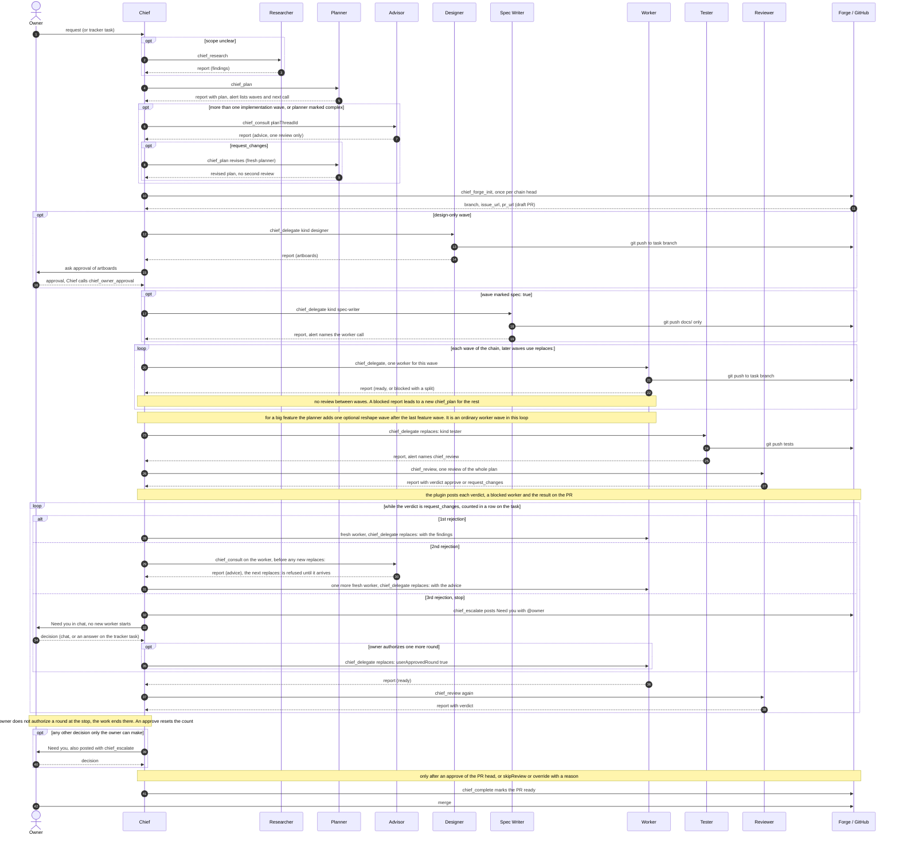
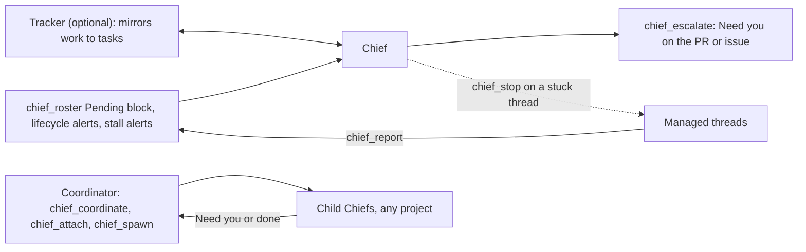

# Software Factory

This page shows how Chief turns one owner request into a merged pull request. The sequence chart shows who messages whom. The tables list the roles and the support tools.

> **Keep this page current.** When a change alters a tool, a role kind, a gate, or the order of steps, update the charts and tables in the same pull request. The code and the skills win over this page: `server.ts`, `src/core/roles.ts`, `skills/chief/SKILL.md`, and the README "Workflow" and "Planning" sections.

## Chart

> **Note.** The waves of one chain run one after another on one branch, each worker continuing the last through `replaces:`. Separate chains (separate branches and pull requests, started with `dependsOn: []`) can run in parallel.

A solid arrow is a tool call or a push. A dashed arrow is a `chief_report` that the plugin turns into a lifecycle alert for Chief, or an owner message. Every managed thread reports to Chief only. Threads never message each other. The one exception is the pull-only plan log (`chief_log`), which carries no alert.

## Support tools

Support tools run beside the pipeline. This chart shows who reaches Chief and who does not.

| Tool | Use |
| --- | --- |
| `chief_research` | Read-only survey or investigation by a researcher thread. Chief uses it before a plan or to check doubtful evidence. |
| `chief_consult` | Read-only advisor. It gives a plan its one review, and Chief must call it after the second `request_changes` in a row. |
| `chief_roster` | Starts every Chief turn. Its Pending block is the work list. |
| `chief_escalate` | Posts a **Need you** request on the pull request or issue with an @mention of the owner. Chief also writes it in chat. |
| `chief_stop` | Interrupts a stuck thread. It keeps the worktree, branch and history. |
| `chief_coordinate` | Upgrades a Chief to a Coordinator. It wakes only on a child's Need you or done. |
| Tracker | Mirrors each plan or unplanned worker to a task. The owner's answer on the task reaches Chief once, as an alert. |

## Gates

| Step | Rule |
| --- | --- |
| Plan | With planning on, `chief_delegate` refuses a call without `planThreadId` and `wave`, unless it carries `unplannedReason`. A plan has 2 to 8 waves. Each chain ends with a test wave. |
| Plan review | `chief_forge_init` and `chief_delegate` refuse a qualifying plan until its one advisor review resolves. There is no skip. |
| Forge | Chief owns the forge. `chief_forge_init` runs on a chain head with no worker yet. A worker never touches the pull request. |
| Review | `chief_review` is refused for an intermediate wave, a design wave, and while any wave is not ready. `skipReview` on `chief_complete` needs a reason. |
| Complete | `chief_complete` needs the newest review to approve the PR's current head. `skipReview` or `override` with a reason bypass it. A design wave needs the owner's approval. A Spec Writer is never completed. |
| Merge | Only the owner merges. Chief never merges. |

## Roles inside a plan chain

A plan chain has one branch, one pull request and one worker worktree. Worker kinds come from `workerKindSchema` in `src/core/roles.ts`. Planner, Advisor, Researcher and Reviewer are thread roles.

| Role | Kind or thread role | Job | Waived by |
| --- | --- | --- | --- |
| Designer | `kind: "designer"` | Decides or implements how the UI looks. A design-only wave draws artboards. | n/a |
| Spec Writer | `kind: "spec-writer"` | Changes only `docs/`. Runs first on a `spec: true` wave. | `chief_skip_specs` |
| Worker | `kind: "worker"` | Implements one wave. It never writes tests. A reshape wave is also a worker. | n/a |
| Tester | `kind: "tester"` | Writes and runs the tests for the waves it builds on. | `chief_skip_tests`, or `testsSkipped` on `chief_complete` |
| Reviewer | thread role `reviewer` | Reports a `verdict` of `approve` or `request_changes`. It never edits. | `skipReview` |
| Planner | thread role `planner` | Read-only. Splits the work into waves. | `unplannedReason` |
| Advisor | thread role `advisor` | Read-only. Reviews a plan or helps a stuck review. | n/a |
| Researcher | thread role `researcher` | Read-only. Runs `chief_research` and reports the findings. | Optional |

A fresh worker takes every follow-up through `replaces:`. A worker that already reported is never reused.

## Related

- [Plan chains](specs/plan-chains.md)
- [Review engine](specs/review-engine.md)
- [Work list](specs/work-list.md)
- [Coordinator](specs/coordinator.md)
- [Tracker](specs/tracker.md)
- [Forge comments](specs/forge-comments.md)
